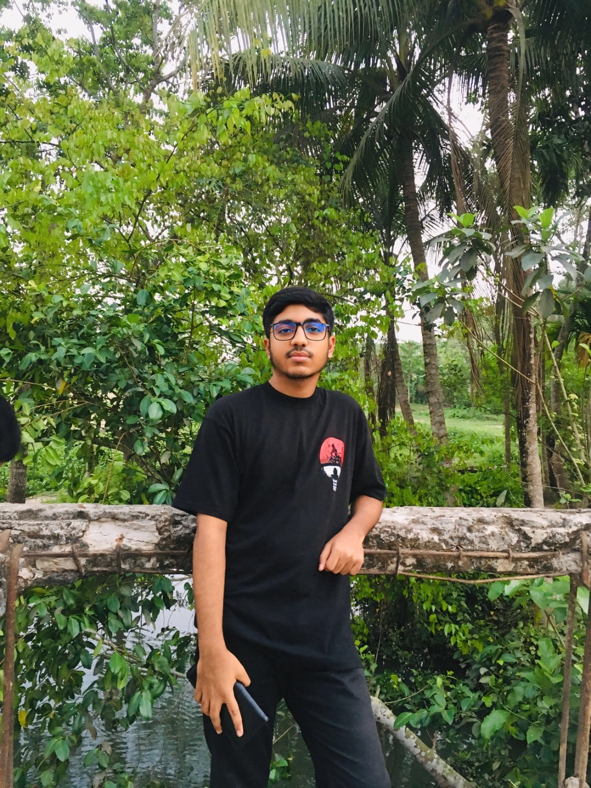

<div align="center">
  

  <h1>Shanto<span style="color:#AEFF72">.dev</span></h1>
  <p><strong>Interfaces with intent. Experiences with a little motion.</strong></p>
  <p>A personal portfolio for selected work, the tools behind it, and the next good collaboration.</p>

  <p>
    <a href="https://nextjs.org/"></a>
    <a href="https://react.dev/"></a>
    
  </p>
</div>

---

### The idea

This site is a snapshot of how I build for the web: clear layouts, responsive details, and interactions that feel natural. It brings together an introduction, a toolkit, a project carousel, and a direct way to get in touch—all in one place.

<table>
  <tr>
    <td width="33%" valign="top"><strong>01 / Meet</strong><br />A short introduction and a little context about the developer.</td>
    <td width="33%" valign="top"><strong>02 / Explore</strong><br />Skills and selected projects, with source and live-preview links.</td>
    <td width="33%" valign="top"><strong>03 / Connect</strong><br />A contact form that sends messages over Gmail SMTP.</td>
  </tr>
</table>

### The toolkit

| What | Stack |
| --- | --- |
| Foundation | Next.js 16 · React 19 |
| UI | JavaScript · TypeScript · Tailwind CSS 4 |
| Movement | Framer Motion · GSAP · Lenis |
| Project showcase | Swiper · React Fast Marquee |
| Icons & email | Lucide React · React Icons · Nodemailer |

### Run it locally

```bash
git clone https://github.com/webdevshanto/shanto-portfolio.git
cd shanto-portfolio
npm install
npm run dev
```

Visit [localhost:3000](http://localhost:3000) and take a look around.

<details>
  <summary><strong>Set up the contact form</strong></summary>

  The contact endpoint sends email through Gmail SMTP. Create `.env.local` in the project root and add a Gmail address and [Google App Password](https://support.google.com/accounts/answer/185833):

  ```env
  EMAIL_USER=your-email@gmail.com
  EMAIL_PASS=your-gmail-app-password
  ```

  Restart the dev server after saving. Keep these credentials private; `.env.local` is git-ignored.
</details>

### Useful commands

```bash
npm run dev      # Start the local development server
npm run build    # Create a production build
npm run start    # Serve the production build
npm run lint     # Run ESLint
```

### Where things live

```text
app/
├── api/contact/       Contact form endpoint
├── component/         Portfolio sections and UI
├── globals.css        Global styles
├── layout.tsx         Root layout and metadata
└── page.tsx           Home page
public/                Static files, including the CV
```

---

<div align="center">
  <p><strong>Have something interesting in mind?</strong></p>
  <a href="mailto:webdevshanto2007@outlook.com">Let's make it happen ↗</a>
  <br /><br />
  <sub>Designed and built by Shanto · Next.js, React & a bit of motion</sub>
</div>
